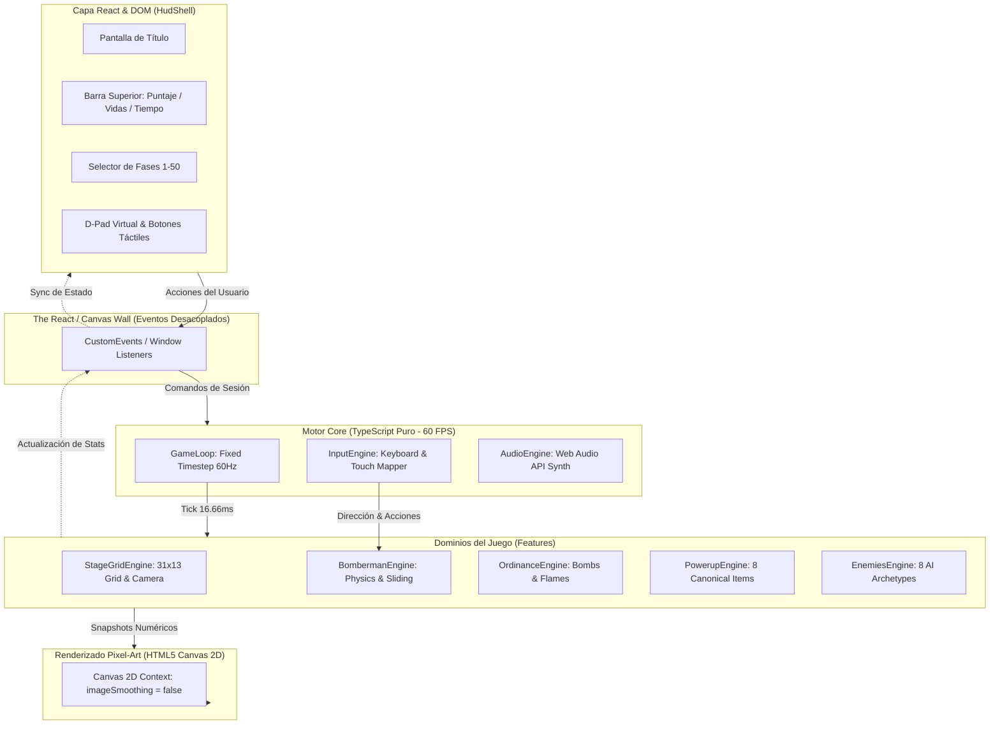

# 💣 Bomberman NES (1985) — Faithful Web Engine & Remake

[](https://bomberman-nes-web.vercel.app/)
[](https://www.typescriptlang.org/)
[](https://vitejs.dev/)
[](https://react.dev/)
[](https://vitest.dev/)
[](LICENSE)

> Recreación hiperfiel del legendario **Bomberman (Hudson Soft / Nintendo, 1985)** para la Nintendo Entertainment System (NES), ejecutándose de forma nativa en navegadores web modernos con física determinista a 60 FPS, síntesis de audio procedural Web Audio API de 8 bits y pixel art canónico.

---

## 🕹️ Probar en Línea (Demo en Vivo)

Puedes jugar directamente en tu navegador (PC, Tablet o Móvil) sin instalar nada:

👉 **[https://bomberman-nes-web.vercel.app/](https://bomberman-nes-web.vercel.app/)** 👈

---

## 📖 Tabla de Contenidos

- [Características Principales](#-características-principales)
- [Arquitectura de Software](#-arquitectura-de-software)
- [Catálogo Canónico de Enemigos (8 Arquetipos)](#-catálogo-canónico-de-enemigos-8-arquetipos)
- [Sistema de Power-Ups](#-sistema-de-power-ups)
- [Motor de Audio Procedural 8-Bit (NES Soundchip)](#-motor-de-audio-procedural-8-bit-nes-soundchip)
- [Controles de Juego](#-controles-de-juego)
- [Instalación y Desarrollo Local](#-instalación-y-desarrollo-local)
- [Suite de Pruebas Unitarias (Vitest)](#-suite-de-pruebas-unitarias-vitest)
- [Estructura del Repositorio](#-estructura-del-repositorio)

---

## ✨ Características Principales

1. **Física Determinista a 60 FPS (Fixed-Step Loop):**
   - Lógica de movimiento en cuadrícula de $16 \times 16\text{ px}$.
   - Asistencia en esquinas (*Corner Sliding Assistance*) de hasta $4\text{ px}$ para evitar atascos en pasillos.
   - Hurtboxes letales centradas de $8 \times 8\text{ px}$ para combate cerrado táctico.
   - Prevención de atravesamiento de bloques (*Hard Leading-Edge Collision Guard*) y encierro hermético de enemigos (*Trapped State*).

2. **50 Niveles Canónicos de la NES (`STAGE_ENEMY_ROSTERS`):**
   - Distribución de enemigos idéntica a la ROM original de 1985 desde la Fase 1 hasta la Fase 50.
   - Selector de nivel integrado en el menú para pruebas o juego directo.
   - Sistema de *Continue* que preserva mejoras permanentes (bombas, fuego, velocidad) con 3 vidas.

3. **Mecánicas de Castigo y Reglas de Memoria NES:**
   - Límite duro de memoria RAM de la NES: máximo 10 slots activos (`MAX_ACTIVE_ENEMIES = 10`).
   - Al llegar el reloj a `0:00`: no hay muerte súbita; se genera una horda de **Pontans** ocupando los slots vacíos para permitir farmear puntos (8000 pts base + combos).
   - Trampas de la puerta (`DOOR_REVEALED`) y de los power-ups (`POWERUP_REVEALED`) con invocación de olas de castigo escaladas e inmunidad de nacimiento (`spawnImmunityMs = 520`) para prevenir exploits.
   - Multiplicadores de combo simultáneo al destruir múltiples enemigos con una sola explosión ($1\times, 2\times, 4\times, 8\times$).

4. **Soporte Móvil y de Escritorio:**
   - Controles de teclado completos con cancelación de direcciones opuestas y prioridad de última tecla.
   - D-Pad virtual y botones táctiles en pantalla adaptados para dispositivos móviles y pantallas táctiles.

---

## 🏛️ Arquitectura de Software

El proyecto sigue dos patrones arquitectónicos estrictos para garantizar escalabilidad, rendimiento y desacoplamiento:



### Principios Clave:
- **`The React / Canvas Wall`**: React **nunca** renderiza el juego frame a frame ni almacena estados de entidades móviles. La UI de React (`HudShell`) se comunica mediante `CustomEvents` limpios con los motores de juego en TypeScript puro.
- **`Screaming Game Architecture`**: Cada funcionalidad vive en su propio módulo (`src/features/*`), con especificación técnica (`spec.md`), contratos de tipos (`types.ts`), lógica matemática (`*.engine.ts`), renderizado desacoplado (`*.renderer.ts`) y pruebas unitarias (`*.test.ts`).

---

## 👾 Catálogo Canónico de Enemigos (8 Arquetipos)

Todos los enemigos emulan con precisión las velocidades en píxeles por fotograma a 60Hz y los patrones de toma de decisiones de la ROM de 1985:

| Enemigo | Apariencia | Puntos | Velocidad (px/tick) | Wallpass (Atraviesa Bloques) | Comportamiento & IA |
| :--- | :--- | :---: | :---: | :---: | :--- |
| **`BALLOM`** | Globo naranja con ojos | 100 | `0.375` (22.5 px/s) | ❌ No | Inercia de pasillo. Movimiento mayormente lineal, gira aleatoriamente en intersecciones abiertas. |
| **`ONEAL`** | Cebolla azul con patas | 200 | `0.500` / `0.650` burst | ❌ No | Patrulla pasillos. Detecta línea de visión hacia Bomberman hasta a 8 casillas y acelera para perseguirlo. |
| **`DAHL`** | Barril rojo giratorio | 400 | `0.625` (37.5 px/s) | ❌ No | Hipercinético. Alterna constantemente entre ejes horizontales y verticales al completar cuotas de 2 a 4 tiles. |
| **`MINVO`** | Rostro verde agresivo | 800 | `0.750` (45.0 px/s) | ❌ No | Perseguidor implacable por pasillos. Da media vuelta (75%) si se aleja de Bomberman y gira hacia él en cruces. |
| **`KONDORIA`** | Ameba azul flotante | 1000 | `0.250` (15.0 px/s) | ✅ Sí | Muy lento pero implacable. Atraviesa bloques destructibles buscando siempre la menor distancia Manhattan. |
| **`OVAPE`** | Fantasma morado | 2000 | `0.375` (22.5 px/s) | ✅ Sí | Atraviesa bloques destructibles deambulando libremente en patrullas periódicas. |
| **`PASS`** | Máscara / león naranja | 4000 | `1.000` (60.0 px/s) | ❌ No | Depredador ultra rápido. Persigue activamente a Bomberman a través de pasillos sin cruzar bloques. |
| **`PONTAN`** | Disco naranja giratorio | 8000 | `1.125` (67.5 px/s) | ✅ Sí | El enemigo más veloz y letal. Cruza bloques destruibles con persecución implacable al llegar el reloj a 0:00. |

---

## 🍄 Sistema de Power-Ups

Se encuentran ocultos bajo los bloques rompibles (`SOFT_BLOCK`), garantizando exactamente un ítem por nivel según la tabla oficial:

| Ítem | Nombre | Efecto | Duración |
| :---: | :--- | :--- | :--- |
| 💣 | **`BOMB`** | Incrementa en +1 la capacidad máxima de bombas simultáneas. | Permanente |
| 🔥 | **`FLAME`** | Aumenta el radio de la explosión en +1 casilla en cruz. | Permanente |
| 👟 | **`SPEED`** | Aumenta la velocidad de caminata de Bomberman a $1.5\text{ px/tick}$. | Permanente |
| 🧱 | **`WALLPASS`** | Permite a Bomberman caminar a través de ladrillos blandos destruibles. | Nivel actual |
| 📡 | **`DETONATOR`** | Permite detonar las bombas a voluntad presionando la tecla de detonación (`Z` o `K`). | Permanente |
| 🛡️ | **`BOMBPASS`** | Permite a Bomberman atravesar sus propias bombas sólidas sin quedar atrapado. | Nivel actual |
| 🦺 | **`FLAMEPASS`** | Inmunidad total al fuego de las explosiones de bombas. | Nivel actual |
| ❓ | **`MYSTERY`** | Invulnerabilidad divina temporal frente a contacto con enemigos y flamas. | 30 segundos |

---

## 🔊 Motor de Audio Procedural 8-Bit (NES Soundchip)

El sistema de sonido no utiliza archivos `.mp3` ni `.wav` grabados: emula matemáticamente mediante **Web Audio API** los canales del procesador de audio de la NES (Ricoh 2A03):

- **Canales Pulse / Square 1 & 2 (`OscillatorNode` tipo `'square'`):** Sintetizan la melodía principal, armonías, colocación de bombas, obtención de potenciadores y fanfarrias.
- **Canal Triangle (`OscillatorNode` tipo `'triangle'`):** Genera las líneas de bajo y el sonido percusivo rítmico de pasos al caminar.
- **Canal Noise LFSR Crunch:** Generación de ruido blanco escalonado en bloques para recrear la textura crujiente de 8 bits, complementado con una capa Sub-Bass Boom para explosiones contundentes.
- **BGM Completo:**
  - Tema de Título / Menú.
  - Fanfarria de Inicio de Nivel (*Stage Intro*).
  - Tema Principal (*Stage Theme BGM*).
  - Fanfarria de Poder (*Powerup BGM*).
  - Efecto de Pausa con congelamiento de audio.

---

## 🎮 Controles de Juego

| Acción | Teclas Primarias | Teclas Secundarias | Control Táctil (Móvil) |
| :--- | :---: | :---: | :---: |
| **Mover Arriba** | `▲ Flecha Arriba` | `W` | D-Pad ▲ |
| **Mover Abajo** | `▼ Flecha Abajo` | `S` | D-Pad ▼ |
| **Mover Izquierda** | `◄ Flecha Izquierda` | `A` | D-Pad ◄ |
| **Mover Derecha** | `► Flecha Derecha` | `D` | D-Pad ► |
| **Poner Bomba** | `X` / `Barra Espaciadora` | `J` | Botón **B** (Rojo) |
| **Detonador Remoto** | `Z` | `K` | Botón **A** (Azul) |
| **Pausa / Reanudar** | `Enter` | `P` / `Escape` | Botón **PAUSE** |
| **Silenciar Audio** | `M` | — | Botón **MUTE** |
| **Debug Hitboxes** | `F2` | — | — |

---

## 💻 Instalación y Desarrollo Local

### Requisitos Previos
- [Node.js](https://nodejs.org/) v18+ o superior.
- Gestor de paquetes `npm` (incluido con Node).

### Pasos de Instalación

1. **Clonar el repositorio:**
   ```bash
   git clone https://github.com/tu-usuario/bomberman.git
   cd bomberman
   ```

2. **Instalar dependencias:**
   ```bash
   npm install
   ```

3. **Iniciar el servidor de desarrollo local:**
   ```bash
   npm run dev
   ```
   Abre [http://localhost:5173](http://localhost:5173) en tu navegador.

4. **Compilar para producción:**
   ```bash
   npm run build
   ```

5. **Previsualizar la build de producción localmente:**
   ```bash
   npm run preview
   ```

---

## 🧪 Suite de Pruebas Unitarias (Vitest)

El motor cuenta con una cobertura integral de pruebas unitarias que verifican cada mecánica frente a la física y reglas de la ROM original de NES:

```bash
npm test
```

### Resultados de la Suite:
```text
 ✓ src/core/input/input.test.ts (11 tests)
 ✓ src/core/loop/loop.test.ts (21 tests)
 ✓ src/core/audio/audio.test.ts (20 tests)
 ✓ src/features/stage-grid/stage-grid.test.ts (20 tests)
 ✓ src/features/powerups/powerups.test.ts (35 tests)
 ✓ src/features/bomberman/bomberman.test.ts (24 tests)
 ✓ src/features/ordinance/ordinance.test.ts (20 tests)
 ✓ src/features/enemies/enemies.test.ts (62 tests)

 Test Files  8 passed (8)
      Tests  213 passed (213)
```

Entre las pruebas críticas destacan:
- Inercia de pasillos e invariantes de decisión de los 8 enemigos.
- Guardia dura de colisión de borde delantero (*Hard Leading-Edge Guard*).
- Prevención total de tunneling y fases fantasma a través de `SOFT_BLOCK`.
- Límites de slots de memoria RAM de la NES (`MAX_ACTIVE_ENEMIES = 10`).
- Detección precisa de hurtboxes letales de $8 \times 8\text{ px}$.
- Combos multiplicadores simultáneos de bombas.

---

## 📁 Estructura del Repositorio

```text
bomberman/
├── index.html                   # Entry point HTML con viewport configurado para pixel-art
├── vite.config.ts               # Configuración de empaquetado Vite + React + Tailwind
├── tsconfig.json                # Configuración estricta de TypeScript 5.7
├── package.json                 # Scripts y dependencias del proyecto
└── src/
    ├── main.tsx                 # Ensamblador del ciclo de vida y orquestador del Canvas
    ├── index.css                # Estilos globales y fuentes retro
    ├── core/                    # Módulos agnósticos a la vista
    │   ├── loop/                # Game loop determinista a 60 FPS
    │   ├── input/               # Gestor de entradas de teclado y mapeos
    │   └── audio/               # Motor de síntesis Web Audio API (Chiptune 8-bit)
    ├── features/                # Dominios del juego (Screaming Architecture)
    │   ├── stage-grid/          # Grilla 31x13, bloques, cámara con scroll horizontal
    │   ├── bomberman/           # Entidad del jugador, física, animaciones y vidas
    │   ├── ordinance/           # Bombas, temporizadores, flamas y detonador remoto
    │   ├── powerups/            # 8 Potenciadores canónicos, drop rates y efectos
    │   ├── enemies/             # 8 Arquetipos de IA, hordas, combos y colisiones
    │   └── hud-shell/           # Interfaz React, HUD superior, controles táctiles y menús
    └── shared/                  # Recursos y constantes comunes
        └── sprites/             # Matrices y utilidades de renderizado pixel-art 16x16
```

---

## 📜 Licencia y Créditos

- **Licencia:** Código fuente bajo licencia MIT.
- **Tributo:** Este proyecto es un homenaje técnico y educativo al videojuego original **Bomberman (1985)** creado por Hudson Soft para la consola Famicom / Nintendo Entertainment System (NES). Todos los derechos del diseño original pertenecen a sus respectivos propietarios.
- **Demo Oficial:** [https://bomberman-nes-web.vercel.app/](https://bomberman-nes-web.vercel.app/)
